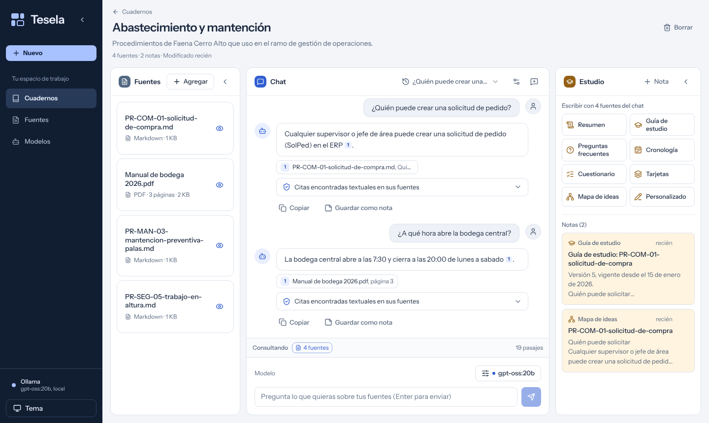
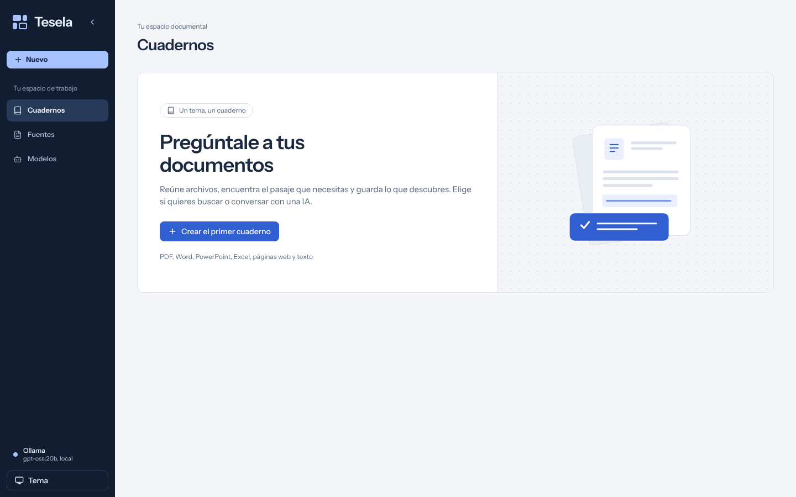
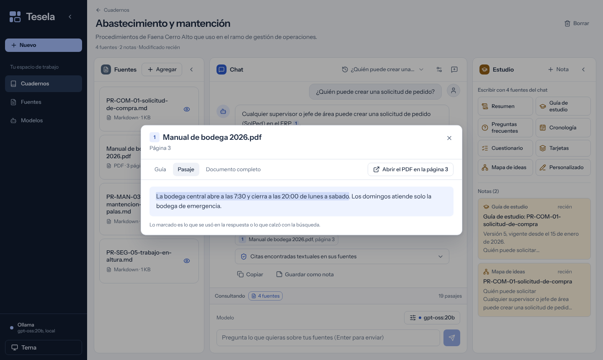
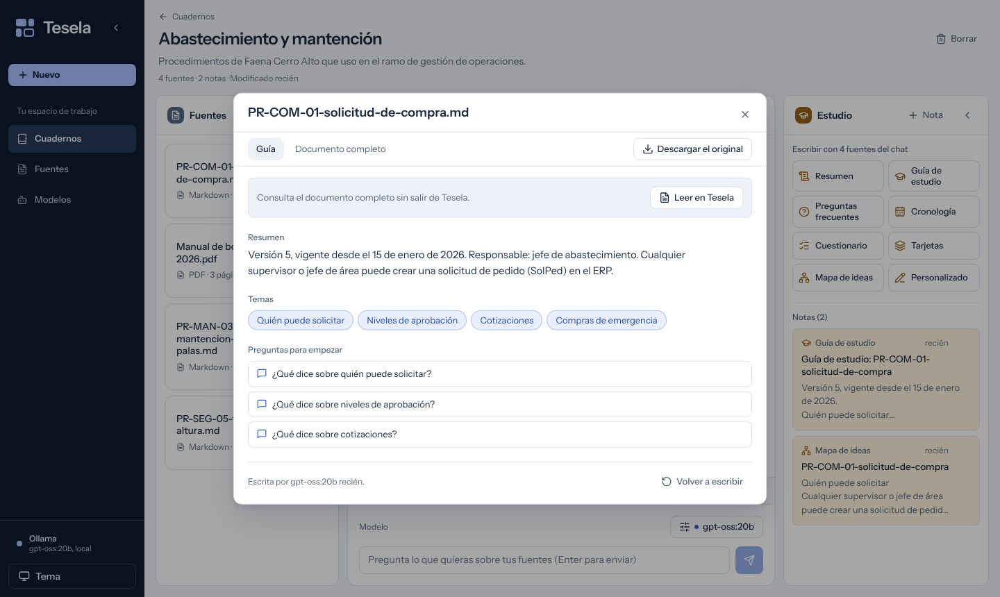
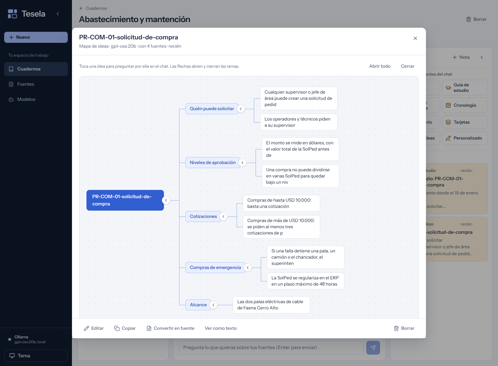
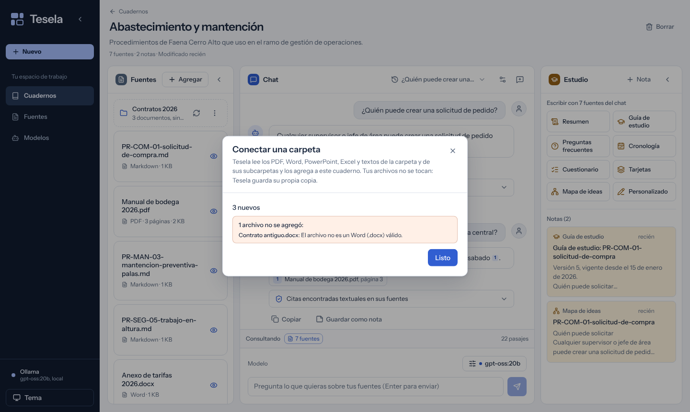
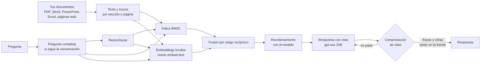

<div align="center">

# Tesela

**Un lugar para tus documentos, conversaciones y notas. Pregunta y revisa el pasaje que respalda cada respuesta.**

[**Abrir en el navegador**](https://vewachholtz-ops.github.io/rag-documentos-local/app/) | [**Instalar**](#instalar) | [Respuestas reales de la evaluación](https://vewachholtz-ops.github.io/rag-documentos-local/) | [Cómo funciona](docs/como-funciona.md) | [Evaluación](docs/evaluacion.md)

[](https://github.com/vewachholtz-ops/rag-documentos-local/actions/workflows/ci.yml)


[](#licencia)

<sub><i>A local document workspace with notebooks, sources, chat and notes. Hybrid BM25 + embedding search, query rewriting, reranking and verbatim citation checks. Answers with local Ollama, an OpenAI-compatible API, or no AI at all (search only). Connect a folder and keep it in sync.</i></sub>



</div>

Con Ollama y en modo solo buscar, el procesamiento queda en tu computador. Si eliges una API remota,
se envían al proveedor la pregunta, el contexto reciente de conversación que se use y los pasajes que el modelo
necesita revisar. La app muestra el modo elegido.

## Qué hace

**Cuadernos.** Cada tema tiene sus fuentes, sus notas y sus conversaciones. Un documento puede estar en varios cuadernos sin copiarse, y cada fuente se puede dejar fuera del chat con un toque.

**Tus documentos.** PDF, Word, PowerPoint (con las notas del orador), Excel, CSV, HTML, Markdown o texto: arrástralos al cuaderno. O pega el **enlace de una página web**: Tesela guarda su texto, sin menús ni publicidad. Se indexan una vez y quedan guardados.

**La guía de cada fuente.** De qué trata, sus temas y preguntas para empezar. Tocar un tema o una pregunta la manda al chat.

**Respuestas con su fuente.** Cada dato lleva un número de cita. Al tocarlo se abre el pasaje con la frase marcada y, si es un PDF, la página.

**Revisa lo que cita.** Comprueba que cada frase copiada esté textual en su documento y que las cifras aparezcan ahí; si algo no calza, le pide al modelo que corrija. Si la respuesta no está en tus documentos, lo dice.

**Estudio.** Con las fuentes del chat, el modelo escribe un resumen, una guía de estudio, preguntas frecuentes, una cronología, un **cuestionario** que se responde en la app, **tarjetas** de memoria para dar vuelta, un **mapa de ideas** que se abre por ramas o lo que le pidas. Todo queda como nota. Los documentos largos se leen por partes (un modelo local no los lee de una vez) y las cifras que no están en las fuentes se avisan.

**Notas.** Escribe las tuyas (en Markdown) o guarda una respuesta, con sus fuentes, en un toque. Una nota se puede convertir en fuente.

**Varias conversaciones** por cuaderno, cada una con su historial. El chat se configura: respuestas cortas, normales o detalladas, e indicaciones propias ("explícalo con ejemplos").

**Carpetas conectadas.** Conecta una carpeta del computador a un cuaderno: Tesela lee sus documentos y, al sincronizar, agrega los nuevos, actualiza los que cambiaron y quita los que borraste. Tus archivos no se tocan.

**La IA que tengas.** [Ollama] en el computador (nada sale de la máquina), una API compatible con OpenAI (OpenAI, Groq, OpenRouter, LM Studio) para equipos que no pueden correr un modelo, o **solo buscar**, sin IA: los pasajes que más calzan, con las palabras marcadas.

## Instalar

**Sin instalar nada:** [abre Tesela en el navegador](https://vewachholtz-ops.github.io/rag-documentos-local/app/).
Es la misma app con el mismo motor, que corre en tu navegador (Python con [Pyodide](https://pyodide.org)): tus
documentos quedan guardados ahí y no se suben a ningún servidor. Busca sin IA o responde con la API que elijas; la
versión instalada suma Ollama (IA en tu computador), carpetas conectadas y páginas web por enlace.

**Instalada, en Windows 10 u 11:** abre **PowerShell** (tecla Windows, escribe «PowerShell» y Enter) y pega esta línea:

```powershell
irm https://raw.githubusercontent.com/vewachholtz-ops/rag-documentos-local/main/instalar.ps1 | iex
```

Deja Tesela en tu carpeta de usuario (`%LOCALAPPDATA%\Tesela`), pregunta si instalar [Ollama](https://ollama.com)
para responder con IA en tu computador, crea el acceso directo «Tesela» en el escritorio y en el menú Inicio, y la
abre. Si faltan los modelos, la app ofrece descargarlos (gpt-oss 20B pesa unos 13 GB). Para **actualizar**, se pega
la misma línea: tus documentos, cuadernos y notas se conservan. Lo que hace el instalador, paso a paso, está en
[`instalar.ps1`](instalar.ps1).

Sin PowerShell: descarga el proyecto (**Code → Download ZIP**), descomprímelo y haz doble clic en
**`abrir-app.bat`**; la primera vez instala lo necesario y ofrece el acceso directo.

Sin Ollama también abre: en **Modelos** se elige una API compatible con OpenAI o el modo solo buscar.
En otro sistema: `uv sync` y `uv run rag servir`. Los documentos, cuadernos y notas quedan en `biblioteca/`;
los documentos, como copia: quitar uno de Tesela no borra el original.

## Ventajas de Tesela

| Ventaja | Qué permite |
|---|---|
| **Consultar sin depender de un servicio en la nube** | Con Ollama, los documentos y las respuestas se procesan en tu computador. También puedes buscar pasajes sin usar un modelo. |
| **Elegir el modelo y dónde ejecutarlo** | Usar Ollama local o una API compatible con OpenAI según tu equipo. Si eliges una API remota, la app avisa qué información se envía al proveedor. |
| **Revisar las citas en el documento** | Abrir el pasaje citado y la página del PDF. El motor comprueba las frases y cifras citadas; esa comprobación ayuda a revisar la evidencia, pero no garantiza que la interpretación sea correcta. |
| **Mantener una carpeta al día** | En la versión instalada, sincronizar documentos nuevos, modificados o eliminados sin alterar los archivos originales. |
| **Pasar de las fuentes al estudio** | Preparar guías, cuestionarios, tarjetas y mapas de ideas, guardar respuestas como notas y convertir notas en fuentes dentro del mismo cuaderno. |
| **Elegir entre navegador e instalación local** | Probar la búsqueda desde la web sin instalar, o instalar Tesela para sumar Ollama, carpetas conectadas y páginas web por enlace. |

Todavía no incluye generación de audio o video, importación de YouTube y audio, búsqueda de fuentes en internet ni cuadernos compartidos.

## Estado actual

Los flujos de la app se comprueban con un modelo simulado. El servidor solo atiende a la propia app (127.0.0.1,
Origin, CSP y un token nuevo en cada apertura), pone topes a los archivos que se inflan al leerlos y no deja que un
enlace apunte a la red local. Pendientes: embeddings por API.

La revisión en Windows pasó 206 pruebas con un Ollama simulado. También se comprobó la versión web con el CDN
real: crear un cuaderno, agregar texto y buscar un pasaje. Las pruebas automáticas de Pyodide requieren una copia
local de ese motor y se omiten cuando no está disponible. Falta probar Tesela con gpt-oss de verdad y con una API
real.



Al tocar una cita se abre el pasaje con la frase marcada, la guía de la fuente, su texto completo y el PDF en su página:



La guía de una fuente: tocar un tema o una pregunta la manda al chat.



Un mapa de ideas escrito con las fuentes: las ramas se abren y se cierran, y tocar una idea la pregunta en el chat.



Conectar una carpeta: lo que no se puede leer queda explicado.



<sub>Las capturas se toman con el modelo simulado de las pruebas, que responde copiando la oración que más calza (`uv run python scripts/capturas.py` las rehace); las respuestas reales de gpt-oss están en la evaluación, más abajo.</sub>

## Evaluación histórica de Fuente

Antes de convertirlo en app, el motor de Fuente se evaluó con 74 preguntas sobre 24 procedimientos de una mina
ficticia, con documentos parecidos entre sí, una versión obsoleta y 12 preguntas trampa cuya respuesta no está.
Estos resultados pertenecen a aquella configuración y corpus; **no son una medición de exactitud de Tesela**.

| | Versión inicial | Versión de Fuente |
|---|---:|---:|
| Respuestas correctas, preguntas con respuesta | 54 de 62 | **60 de 62** |
| Trampas rechazadas | 11 de 12 | 11 de 12 |
| Sección correcta en el primer resultado de la búsqueda | 69 % | **98 %** |
| Segundos por pregunta | 11 | 35 |

Los tres errores de la versión de Fuente no son de búsqueda: el modelo tenía delante la sección correcta y la leyó mal (en p72 citó una frase real sobre las superintendencias para responder por las gerencias). Esa es la razón de mostrar siempre el pasaje: la comprobación revisa que la cita exista, no que la conclusión sea correcta.

Las [respuestas reales de la evaluación](https://vewachholtz-ops.github.io/rag-documentos-local/) se pueden recorrer sin instalar nada, con sus aciertos y errores. Tablas completas, cómo se evaluó y los límites: [docs/evaluacion.md](docs/evaluacion.md).

## Cómo funciona

El flujo con IA reutiliza las etapas del motor de Fuente. Los embeddings son opcionales y locales;
sin ellos se busca por palabras. El modo solo buscar entrega pasajes sin generar una respuesta.



Paso a paso, la app por dentro y de qué proyectos salió cada idea: [docs/como-funciona.md](docs/como-funciona.md).

## Para desarrollar

```bash
uv sync
uv run rag servir                 # la app en http://127.0.0.1:8000
uv run pytest                     # las pruebas, sin Ollama (un Ollama de mentira en tests/ollama_falso.py)
uv run rag evaluar                # la evaluación completa con los procedimientos (unas 3 horas; evaluar.bat)

cd interfaz && npm ci             # la interfaz (React): Node 20.19 o más, solo para desarrollarla
npm run build                     # la deja construida en app/, que es lo que se sube

# con recarga en vivo: el token de la sesión tiene que ser el mismo en los dos
MESA_TOKEN=dev uv run rag servir --sin-navegador
MESA_TOKEN=dev npm run dev

# la versión web (site/app/): la interfaz con VITE_WEB=1 y el motor de Python empaquetado para Pyodide
VITE_WEB=1 npm run build && cd .. && uv run python scripts/construir_web.py
```

```
interfaz/           # la interfaz de Tesela: React, TypeScript, Tailwind y Radix
app/                # la interfaz construida (npm run build); la sirve el servidor, sin Node
src/rag_local/      # biblioteca, enlaces, cuadernos, carpetas, estudio, modos de IA, búsqueda, respuesta, comprobación, servidor
                    # y navegador.py, el mismo servidor sin red ni hilos para la versión web
tests/              # sin Ollama; la app, también en un navegador real (Playwright)
documentos/         # los 24 procedimientos ficticios de la evaluación
evaluacion/         # sus 74 preguntas
resultados/         # cada respuesta de la evaluación, con su puntaje
web/, site/         # la página con las respuestas de la evaluación (GitHub Pages); site/app/, la versión web
scripts/            # construir esa página y la versión web, y rehacer las capturas de este README
docs/               # cómo funciona, la evaluación completa e imágenes
```

Las pruebas que abren un navegador se saltan si no hay uno: `uv run playwright install chromium` las habilita.

## Créditos

La organización en cuadernos y Estudio se inspiraron en NotebookLM y en
[Open Notebook](https://github.com/lfnovo/open-notebook) (sin usar su código).
Ideas del motor tomadas de anthropics/claude-cookbooks, llama_index, onyx, kotaemon, ragas, haystack, RankGPT
y llmware; el detalle está en [docs/como-funciona.md](docs/como-funciona.md#de-dónde-salió-cada-idea) y las
licencias en [TERCEROS.md](TERCEROS.md). Los procedimientos de la evaluación son inventados.

## Licencia

Tesela se publica con la licencia [PolyForm Noncommercial 1.0.0](LICENSE): puedes leer el código, usarlo y
modificarlo para estudiar, investigar, en proyectos personales o en una institución educativa o sin fines de
lucro, siempre que mantengas el aviso de autoría. **Cualquier uso comercial** (venderlo, ofrecerlo como servicio o
usarlo dentro de una empresa para ganar dinero) necesita un permiso escrito del autor: escríbeme por
[GitHub](https://github.com/vewachholtz-ops).

Las bibliotecas de otros proyectos que van dentro conservan sus licencias (MIT, ISC, BSD): la lista está en
[TERCEROS.md](TERCEROS.md) y en `app/licencias.txt`. Tipografía Instrument Sans (SIL Open Font License).

[Ollama]: https://ollama.com
