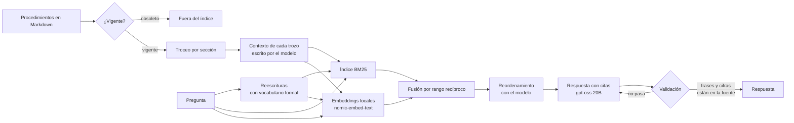

# Cómo funciona

[← Volver al README](../README.md)

Tesela continúa Fuente 3 con una identidad visual propia. El motor mantiene las etapas de búsqueda y
comprobación del proyecto original; las métricas guardadas corresponden a la evaluación histórica de
Fuente, no a una evaluación de Tesela con documentos nuevos.

## El motor evaluado de Fuente

El siguiente flujo corresponde al corpus de procedimientos de la evaluación. El filtro de documentos
obsoletos y el contexto generado por trozo de este flujo no se aplican automáticamente a los archivos que
se importan en la biblioteca de la app.

1. **Vigencia.** Un documento con la línea `Estado: obsoleto` no se indexa: un procedimiento reemplazado no debe responder preguntas, que es lo que exige un control documental.
2. **Troceo por sección.** Cada sección `##` es un trozo con el título del documento y de la sección, así una tabla de aprobaciones no se parte por la mitad.
3. **Contextual Retrieval.** Al indexar, el modelo lee el documento completo y escribe una o dos oraciones que ubican cada trozo ("tolerancia de las pautas de las **palas**", no de los camiones). Ese contexto se indexa junto con el trozo. Técnica de [Anthropic](https://www.anthropic.com/news/contextual-retrieval).
4. **Búsqueda híbrida.** BM25 encuentra las palabras exactas (códigos, montos, "PM2"); los embeddings encuentran lo que se pregunta con otras palabras. Los dos rankings se combinan con *reciprocal rank fusion*. Los embeddings llevan los prefijos `search_document:` y `search_query:` que exige nomic-embed-text.
5. **Reescritura de la consulta.** El modelo propone tres consultas con el vocabulario de un procedimiento ("caja chica" → "fondo fijo") y sus resultados se fusionan con la pregunta original, que pesa el doble que cada reescritura.
6. **Reordenamiento.** El modelo recibe los 20 mejores trozos y los ordena según cuánto sirven para responder. Ollama no tiene un endpoint de reranking, así que lo hace el mismo modelo de chat.
7. **Respuesta con citas textuales.** El modelo cita `[n]` después de cada dato y, al final, copia la frase de cada fuente que lo respalda.
8. **Validación.** La respuesta se acepta solo si cita fuentes que existen, si **cada cifra de dos o más dígitos aparece en las fuentes citadas o en la pregunta** y si **cada frase copiada está textual en su fuente**. Así se revisan también los datos que no son números ("lo aprueba el gerente general"). "No está en los documentos" se acepta solo como respuesta completa. Si algo no pasa, se le pide al modelo que corrija una vez; si sigue sin pasar, se muestra con una advertencia.

## La app

**Tesela** tiene dos partes que corren en el mismo computador:

- **La interfaz** ([`interfaz/`](../interfaz/)): React con TypeScript, Tailwind y Radix, con marca y paleta
  propias, navegación por Cuadernos, Fuentes y Modelos, y el chat al centro entre las fuentes y Estudio.
  La organización en cuadernos se inspiró en NotebookLM y en
  [Open Notebook](https://github.com/lfnovo/open-notebook). `npm run build` la deja en [`app/`](../app/),
  que se sube al repositorio para que usar la app no necesite Node.
- **El servidor** ([`servidor.py`](../src/rag_local/servidor.py), solo la biblioteca estándar de Python): sirve
  `app/` y una API local. Sus rutas están definidas en el mismo módulo.

Lo que pasa por dentro:

- **Agregar un documento** ([`biblioteca.py`](../src/rag_local/biblioteca.py)): lee el PDF (con pypdf, página
  por página), el Word, el PowerPoint (una sección por diapositiva, con sus tablas y las notas del orador) y el
  Excel (cada hoja como tablas de 15 filas con su encabezado, con las fechas como fechas) leyendo su XML sin
  dependencias, un CSV, una página HTML guardada o un texto (UTF-8, UTF-16 o Windows-1252); lo trocea por
  sección o por página, agrupando párrafos o líneas con un objetivo de 180 palabras; calcula los embeddings
  si Ollama está abierto y guarda todo en
  `biblioteca/`. Sin Ollama se indexa solo por palabras y los embeddings se calculan la primera vez que se
  pregunta con él. Un archivo repetido no se agrega dos veces.
- **Una página web** ([`enlaces.py`](../src/rag_local/enlaces.py)): con su enlace, Tesela la descarga una vez y
  guarda su texto como Markdown (títulos, párrafos, listas y tablas; sin menús, pie ni scripts, y si la página
  tiene `<main>` o `<article>`, solo eso). Un enlace a un PDF o a un Word se agrega como ese archivo. Es lo único
  que Tesela trae de internet, y solo cuando la persona pega el enlace: solo http y https, nada de direcciones de
  la red local ni del propio computador (tampoco por una redirección), tope de 10 MB y de 30 segundos.
- **Cuadernos** ([`cuadernos.py`](../src/rag_local/cuadernos.py)): cada uno enlaza documentos de la biblioteca
  (el mismo puede estar en varios), guarda sus notas, sus conversaciones (hasta 50; la primera pregunta les da
  nombre) y qué fuentes quedan fuera del chat, además de cómo responder: respuestas cortas, normales o detalladas
  (que leen 8 pasajes en vez de 5) e indicaciones propias, que se suman a las reglas de las citas sin cambiarlas.
  Un JSON por cuaderno, escrito de forma atómica.
- **Estudio** ([`estudio.py`](../src/rag_local/estudio.py)): lo que el modelo escribe con las fuentes, como el
  panel Studio de NotebookLM y las transformaciones de Open Notebook. La **guía de cada fuente** (resumen, temas
  y tres preguntas para empezar, que el chat sugiere cuando está vacío) y **notas generadas** con las fuentes que
  entran al chat: resumen, guía de estudio, preguntas frecuentes, cronología, cuestionario de alternativas,
  tarjetas de memoria, mapa de ideas o una instrucción propia. La interfaz muestra el mapa como un árbol que se
  abre y se cierra (tocar una idea la pregunta en el chat), las tarjetas para dar vuelta y el cuestionario con
  corrección; si el modelo no siguió el formato, como texto.
  Un modelo local no lee un documento largo de una vez (Ollama trabaja con 8.192 fichas de contexto), así que se
  lee por partes de 12.000 caracteres: de cada parte se toman notas fieles y lo que se escribe sale de esas notas,
  condensadas si no caben (map-reduce). Las notas de cada parte se guardan con el documento, de modo que la
  segunda guía o resumen no lo vuelve a leer. Con muchas partes (más de 36 entre todas las fuentes) se lee una
  muestra repartida por cada documento, y la nota dice qué porcentaje se leyó. Al final se revisan las cifras: las
  que no aparecen en ninguna fuente se avisan, como en el chat. Una tarea del modelo a la vez; si se cierra la
  página o se toca «Cancelar», se detiene en el paso siguiente.
- **Carpetas conectadas** ([`carpetas.py`](../src/rag_local/carpetas.py)): una carpeta del computador queda
  enlazada a un cuaderno. Sincronizar recorre la carpeta (con subcarpetas, hasta 300 documentos), agrega los
  archivos nuevos, vuelve a leer los que cambiaron de tamaño o fecha y saca los que ya no están. La poda solo borra
  de la biblioteca lo que trajo la carpeta y nadie más usa; si el documento ya estaba antes o la persona lo puso
  en otro cuaderno, se queda. No acepta rutas de red ni relativas, no sigue enlaces y nunca relee la carpeta
  donde Tesela guarda sus copias.
- **Con qué responde** ([`proveedores.py`](../src/rag_local/proveedores.py)): Ollama, una API compatible con
  OpenAI (`/chat/completions`) o nada. El índice y la búsqueda permanecen locales. Si la API elegida es remota,
  salen la pregunta, las últimas vueltas de conversación usadas para reformularla y los pasajes que se envían
  para reordenar y responder. La clave queda en `biblioteca/ajustes-secretos.json`, que la API local nunca devuelve.
  Los embeddings por API están pendientes; se usan los de Ollama cuando están disponibles o solo BM25.
- **Preguntar** ([`asistente.py`](../src/rag_local/asistente.py)): si la pregunta sigue la conversación, el modelo
  la reescribe como pregunta completa; después reutiliza búsqueda y comprobación del motor original, con
  instrucciones para documentos cualesquiera. Eso no traslada las métricas históricas a la app actual.
  Los pasos que se ven mientras responde son los de verdad. En el modo
  solo buscar, devuelve los 8 pasajes que más calzan con las palabras de la consulta marcadas.
- **Seguridad local:** el servidor solo escucha en 127.0.0.1 y rechaza pedidos de otras páginas abiertas en el
  navegador (revisa Host, Origin, el tipo de contenido y el tamaño). Además, cada vez que se abre la app genera un
  token al azar que escribe en la página; la API no atiende sin él, así que tampoco otro programa del computador
  que adivine el puerto. Los identificadores de las rutas solo aceptan 12 caracteres hexadecimales y la página va
  con una política de contenido (CSP) que solo carga lo propio. Al leer un archivo hay topes de páginas, tiempo,
  texto extraído, tamaño real del XML de un Word y trozos, para que un archivo chico que se infla no bloquee la
  app. Lo que viene de los documentos se muestra escapado. Quitar un documento borra la copia de Tesela, nunca el
  original.
- **La ventana:** `abrir-app.bat` la abre con Edge o Chrome en modo app (sin pestañas ni barra de direcciones)
  y, la primera vez, ofrece un acceso directo en el escritorio.

Quedan pendientes los embeddings por API y la validación de la app actual con gpt-oss real.

La [página de la evaluación](https://vewachholtz-ops.github.io/rag-documentos-local/) ([`web/`](../web/), armada
en `site/` por `scripts/construir_sitio.py`) muestra lo que respondió el motor en cada pregunta, sin modelo: lo
que se escribe a mano se responde con lo guardado solo si es la misma pregunta; si no, sugiere las parecidas.

## La versión web

La misma interfaz, construida con `VITE_WEB=1`, se publica en GitHub Pages (`site/app/`). No hay servidor: un Web
Worker carga [Pyodide](https://pyodide.org) (Python compilado para el navegador) y el paquete `rag_local` tal cual.
La interfaz sigue pidiendo `api/…`; [`interfaz/src/web/puente.ts`](../interfaz/src/web/puente.ts) desvía esos pedidos
al Worker, y [`navegador.py`](../src/rag_local/navegador.py) los pasa como bytes de HTTP por el mismo `Manejador` de
`servidor.py`, con sus rutas y validaciones. La respuesta vuelve en trozos, así que los avisos de un trabajo largo se
ven a medida que ocurren.

Lo que cambia: no hay hilos (los trabajos corren en el mismo hilo), no hay Ollama ni carpetas conectadas ni páginas
por enlace (el navegador no deja leer el disco ni pedirle páginas a otros sitios), y la biblioteca vive en el
almacenamiento del navegador (IndexedDB). Arranca en modo solo buscar; con una API compatible con OpenAI, las
llamadas salen del navegador directo al servicio elegido (con `pyodide-http`), y la app avisa que la pregunta y los
pasajes salen. Las pruebas: [`tests/test_version_web.py`](../tests/test_version_web.py) en Python común y
[`tests/test_app_web.py`](../tests/test_app_web.py) en Chromium con Pyodide.

## De dónde salió cada idea

Antes de la v2 se leyó el código de los RAG más usados y de buscadores para empresas que no se llaman "RAG", para comparar técnica por técnica. El código de este repo es propio; de los repos con licencia restrictiva o sin licencia se tomaron solo ideas.

| Qué | Visto en | Licencia |
|---|---|---|
| Contextual Retrieval y evaluación con Pass@k por trozo | [anthropics/claude-cookbooks](https://github.com/anthropics/claude-cookbooks) (`capabilities/contextual-embeddings`) | MIT |
| Fusión por rango recíproco con k = 60 y consultas múltiples | [run-llama/llama_index](https://github.com/run-llama/llama_index) (`QueryFusionRetriever`) | MIT |
| Consultas reescritas para el buscador léxico; la vigencia del documento importa | [onyx-dot-app/onyx](https://github.com/onyx-dot-app/onyx) | MIT (edición comunitaria) |
| Pedir el pasaje textual que respalda cada cita | [Cinnamon/kotaemon](https://github.com/Cinnamon/kotaemon) | Apache-2.0 |
| Fidelidad: partir la respuesta en afirmaciones y juzgar cada una | [vibrantlabsai/ragas](https://github.com/vibrantlabsai/ragas), [deepset-ai/haystack](https://github.com/deepset-ai/haystack) | Apache-2.0 |
| Reordenar con el modelo de chat (listwise) | RankGPT (Sun et al., 2023), [castorini/rank_llm](https://github.com/castorini/rank_llm) | Apache-2.0 |
| Revisar las cifras de la respuesta contra las fuentes, sin modelo | [llmware-ai/llmware](https://github.com/llmware-ai/llmware) | Apache-2.0 |
| Flujo base (cargar, trocear, embeber, buscar, generar) | [pguso/rag-from-scratch](https://github.com/pguso/rag-from-scratch), [AllAboutAI-YT/easy-local-rag](https://github.com/AllAboutAI-YT/easy-local-rag) | MIT |

Leer el código sirvió también para no copiar errores: en uno de los notebooks de búsqueda híbrida más citados, los puntajes de BM25 y de los vectores se suman posición por posición estando en órdenes distintos, así que se mezclan trozos diferentes.

## Cómo se verifica

Los tests ([`tests/`](../tests/)) corren sin Ollama: el embedder y el modelo de chat se reemplazan por versiones simuladas. Prueban, entre otras cosas, que:

- los documentos obsoletos queden fuera del índice y la tabla de aprobaciones no se separe de su título;
- BM25 normalice tildes y montos, la fusión calcule bien el puntaje y los vectores encuentren un sinónimo que BM25 no ve;
- el contexto generado se indexe y cambie la búsqueda, y las cachés no repitan llamadas al modelo ni embeddings;
- la reescritura rescate una pregunta coloquial que BM25 solo no encuentra, y una reescritura sola no le gane a la pregunta original;
- el reordenamiento siga el orden del modelo e ignore números inválidos;
- la validación rechace citas inexistentes, cifras inventadas, frases que no están textuales en la fuente y "No está en los documentos" mezclado con afirmaciones, y acepte las cifras que vienen de la pregunta;
- el dato esperado dentro de la frase copiada no cuente como respuesta correcta;
- el juez de fidelidad lea su JSON aunque venga con texto alrededor, y la calibración cuente bien sus aciertos;
- cada pregunta apunte a una sección que de verdad contiene el dato esperado, y la versión obsoleta de verdad dé otra respuesta;
- el puntaje acepte formas alternativas de un mismo dato y se pueda recalcular sin el modelo;
- el experimento completo corra de punta a punta con modelos simulados;
- la frase copiada se ubique en la fuente aunque cambien tildes, mayúsculas o los miles, y se marque celda por celda en una tabla;
- la página publicada conserve cada respuesta guardada, con el aviso donde una cita válida acompaña una respuesta incorrecta, escape el texto del modelo y no cargue nada de afuera;
- la biblioteca lea PDF por página, Word con títulos y tablas, y texto de Windows; rechace un PDF escaneado, un Word con declaraciones y archivos de más de 30 MB; no repita un archivo; y al quitar uno borre su copia y cambie el índice;
- la app reescriba una pregunta de seguimiento y diga de qué documento y página viene cada pasaje;
- el servidor local cree, cambie y borre cuadernos y notas, agregue y saque documentos sin borrarlos de la biblioteca, deje fuera del chat las fuentes apagadas, responda en los tres modos (Ollama, una API compatible con OpenAI con su clave y solo buscar sin llamar a ningún modelo), complete los embeddings que faltan, descargue un modelo, avise si Ollama se cae a mitad, pase la biblioteca de Fuente 2 a un cuaderno, y rechace pedidos de otras páginas (Host, Origin, tipo, tamaño y rutas raras);
- los cuadernos y los ajustes sobrevivan a reiniciar la app, un archivo roto no impida abrir los demás, y la clave de la API quede aparte y no se muestre;
- la API no atienda sin el token de la sesión, los topes contra archivos que se inflan corten a tiempo, y borrar un documento mientras se responde no rompa la respuesta;
- conectar una carpeta agregue, actualice y quite según lo que hay en ella, sin borrar lo que la persona ya tenía o usa en otro cuaderno, sin releer la carpeta de la biblioteca y rechazando rutas de red o relativas;
- PowerPoint salga por diapositiva en el orden de la presentación y con las notas del orador, Excel y CSV como tablas partidas con su encabezado, y HTML sin menús ni scripts;
- una página web se agregue desde su enlace sin menús ni scripts, un PDF enlazado llegue como PDF, y la red local no se pueda pedir ni por una redirección;
- Estudio lea un documento largo por partes una sola vez (con otro modelo, de nuevo), lea una muestra repartida si son demasiadas, escriba los ocho tipos de nota solo con las fuentes del chat, avise las cifras que no están en las fuentes, explique lo que falta (sin fuentes, sin modelo) y se detenga si se cierra la página;
- la guía de una fuente se escriba por partes, quede guardada y sugiera preguntas en el chat; cada conversación lleve su historial y su nombre; y el estilo del chat cambie las instrucciones del modelo;
- las notas se muestren como Markdown seguro (sin scripts ni enlaces raros), y el mapa, las tarjetas y el cuestionario se puedan usar en el navegador;
- la comprobación de unidades marque "10 horas" contra "10 %" y no marque una cifra con la misma unidad o sin unidad.

Las pruebas de [`tests/test_app_navegador.py`](../tests/test_app_navegador.py) abren la app en Chromium con un Ollama de mentira y recorren lo que hace una persona: abrirla por primera vez y crear un cuaderno, agregar un PDF y un Markdown, preguntar, abrir el pasaje de una cita, guardar una respuesta como nota, dejar fuentes fuera del chat, buscar sin IA, descargar un modelo que falta, pasar a solo buscar si Ollama está cerrado, configurar una API sin que la clave vuelva a la página, conectar una carpeta y sincronizarla, agregar una página web desde su enlace, tener varias conversaciones que siguen al recargar, escribir la guía de una fuente y usar sus preguntas, generar en Estudio un mapa de ideas (y preguntar por una idea), un cuestionario, tarjetas y una instrucción propia, cancelar lo que se está escribiendo, configurar el chat, convertir una nota en fuente y, en el celular, que las columnas sean pestañas y nada se salga de la pantalla. Las de [`tests/test_navegador.py`](../tests/test_navegador.py) abren la página de la evaluación (con Playwright) y revisan lo que las de Python no ven: que una pregunta parecida pero distinta ("clase C" en vez de "clase B", otra moneda, otro monto, una negación) se sugiera y no se responda con otra; que cada mensaje diga su versión; que no se pueda mandar otra pregunta mientras responde; y que en el celular los paneles cerrados no se alcancen con el teclado.

La verificación automática de Tesela usa proveedores simulados. Las pruebas con
Ollama y una API real siguen pendientes; las capturas usan el modelo simulado y no acreditan la exactitud de Tesela.

GitHub Actions construye la interfaz y revisa que `app/` calce con `interfaz/`, corre `ruff` y `pytest` (con Chromium) y revisa que `site/` esté al día en cada cambio.
